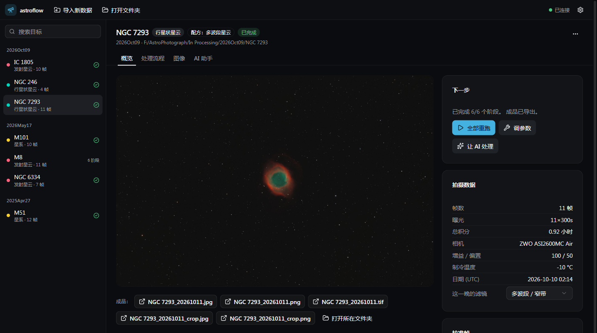

# astroflow

**English** | [简体中文](README.zh-CN.md)

Automated astrophotography post-processing, as a desktop app for Windows and macOS (plus a command line). It organises
a night's frames with matching calibration frames, stacks them with headless WBPP and post-processes them in headless
PixInsight, following recipes learned from tutorial videos. It handles colour cameras and mono cameras (LRGB), and
even comets shot through clouds. It compares every target with top-rated works of the same object, and an AI
assistant (any OpenAI-compatible model: DeepSeek, OpenAI, or a local Ollama / LM Studio) checks each stage and tunes
parameters until the result holds up.

From a night's data to a finished picture: import → frame check → stacking (several nights into one image) → the
recipe for the object type (every parameter adjustable) → comparison with top-rated works → AI review and tuning →
pictures to share.

**[Download](https://github.com/mtang724/astroflow/releases) · [User guide (Chinese)](docs/user-guide.md) ·
[0.2.1 release notes (Chinese)](docs/releases/v0.2.1.md)**



## Desktop app (Windows / macOS)

- **Import new data**: pick a capture folder (exports from ASIAIR, NINA, SharpCap and the like, a memory card, or a
  target folder already split into Light/Dark/Bias/Flat). FITS works, and so do the RAW files of DSLR and mirrorless
  cameras (CR2, CR3, NEF, ARW, DNG, RAF …). Frame types come from the file headers (for RAW files, from the folder
  names). Frames are sorted by target and date. Darks, bias and flats from the same session come first, and anything
  missing comes from the calibration library. A folder with only calibration frames goes into the library and fills
  in targets that lack them. You see the plan before anything happens (files are copied by default; originals stay
  untouched).
- **Target page**:
  - Overview: the finished image, capture details, calibration frames and warnings, the night's filter, and what to do
    next. When a target was shot on several nights, one click stacks them together (each night with its own flats).
  - Frame check: a thumbnail, star count, star size and background for every frame. Frames hurt by clouds, wind,
    focus drift or dawn are flagged and can be excluded in one click (and restored).
  - Processing: every stage and every step's parameters. Edits are saved; you can re-run one stage, or run from a
    stage to the end. Tuned parameters can be saved as "my styles" and applied to similar targets.
  - Images: previews of every stage, the finished image and reference works, with zoom and side-by-side comparison.
  - AI assistant: say what you want in one sentence; it calls the processing tools and you can follow every step.
  - Share pictures: crops to 3:4, 16:9 and other ratios, with capture details and a signature if you like.
- **Mono cameras (LRGB)**: when WBPP stacks one master per filter (L/R/G/B), the mono recipes take over: align the
  channels and crop to the shared area, remove each channel's background, combine the colour, sharpen and denoise L on
  its own, then merge L back at matching brightness (tutorial episode 3).
- **Narrowband**: mono Hα + OIII (HOO, with the stars from R/G/B when shot), mono SII + Hα + OIII (SHO, the Hubble
  palette), a colour camera's Hα + OIII dual-band filter, and a colour camera's two dual-band filter sets (Hα + OIII and
  SII + OIII, stacked apart and combined into SHO). The palette is combined from the aligned lines, balanced (SPCC in
  narrowband mode for HOO), and turned to red/blue or gold/blue through colour masks (tutorial episodes 4 and 5).
- **Process all**: queues every target that has no result yet and stacks and processes them one after another, with a
  system notification when the queue finishes in the background.
- **Job bar**: one PixInsight job at a time, a live log, and Stop at any moment (it ends the PixInsight process).
- **Chinese / English interface**: switch in Settings (follows the system by default); the AI assistant answers in
  the same language.
- **Automatic updates**: checks GitHub for new versions at start. On Windows a new version downloads and installs on
  restart (or the next time the app closes); the macOS preview opens the download page.
- **Disk space and archiving**: see how much space each target takes, delete intermediate files that can be made again
  in one click (raw frames, stacks and finished images stay), and move a finished target to `Processed\` in one click.
- **Setup check**: on first start it checks PixInsight, WBPP, the RC Astro tools (and whether they are activated),
  the Gaia database, the data folder and the AI model, lists what is missing and explains step by step how to install
  it. What it can fix itself (a PixInsight it found, creating the data folder) takes one click.
- **Settings**: data folder, PixInsight location, AI provider (any OpenAI-compatible API, local models included). API
  keys live in the system keychain (Windows Credential Manager / macOS Keychain), never in a file, and the app never
  shows them.

Installers: `desktop/dist/astroflow-<version>-setup.exe` (Windows) and a `.dmg` (macOS, built on a Mac by GitHub
Actions). Development, architecture and packaging: [`desktop/README.md`](desktop/README.md).

## Requirements

- PixInsight 1.9.x (with WBPP), the RC Astro tools (BXT / NXT / SXT), and the Gaia DR3/SP database for SPCC (set up in
  PixInsight)
- Running from source: Python 3.12+ and `pip install -r requirements.txt`; the desktop app also needs Node 24
  (`cd desktop && npm install && npm run dev`)
- Learning from videos (optional, NVIDIA GPU): `pip install -r requirements-video.txt` and ffmpeg

## Command line

```powershell
# Import capture data (preview first, then --apply); --source imports another folder, --copy leaves the lights in
# place; --refresh fills in organised targets from the calibration library
python -m astroflow organize [--apply] [--refresh] [--source <folder>] [--copy]

# Darks shot later on the ASIAIR: once there are enough, import them into the library, recalibrate and stack again
# (run it in PowerShell: Git Bash cannot see network shares)
python -m astroflow.darks --source "\\<ASIAIR IP>\EMMC Images\Autorun\Dark" --exptime 300 --settemp -10 --count 10 --since 2026-10-10 --wait --then restack

# Let the AI process a target (stacking + the whole post-processing + self-check + report), or redo part of it
python -m astroflow agent "M8"
python -m astroflow agent "M8" --task "Redo only the starless stage, with a little more saturation"

# Without AI: run the default recipe, or change one parameter and re-run from one stage
python -m astroflow process "M8"
python -m astroflow process "M8" --from starless --set starless.sat.boost=0.8

# Comets (few frames, mixed exposures, clouds): after WBPP, stack on the stars and on the nucleus separately, then
# finish with the comet recipe
python -m astroflow comet "F:\AstroPhotograph\C2025-R3"

python -m astroflow doctor                 # what this computer is missing, and how to install it
python -m astroflow status                 # progress of every target
python -m astroflow refs "NGC 7293"        # fetch top-rated works of the same object as references
python -m astroflow video "<tutorial.mp4>" # a new tutorial video -> transcript + frames for the knowledge base
```

- **The filter used each night** is stored in `In Processing\<date>\session.json` (FITS headers don't record it; in
  the app you pick it on the target's overview): no filter is `osc_broadband`, a multiband filter such as the Antlia
  Quad Band is `osc_multiband`. It decides the recipe, the colour calibration and which references to compare with.
  Mono cameras need nothing here: each filter has its own master (`..._FILTER-L_mono.xisf`), and the recipe becomes
  `mono_lrgb_*`.
- **Close the PixInsight window while jobs run**: headless jobs need PixInsight to themselves (a second instance can't
  read the Gaia catalogue settings, and BXT crashes). Jobs wait in a queue until it is closed.

## Where the results are
`<data folder>\In Processing\<date>\<target>\Post\`
- `<target>_<date>.png / .jpg / .tif`: the finished image (8-bit full-resolution PNG/JPG, and a 16-bit TIFF for
  further editing in Photoshop); small objects also get a `_crop` version
- `previews\`: a preview of every stage; `report.md`: the AI's processing report; `NN_*.xisf`: each stage's checkpoint
- `params.json`: the parameters you changed in the app, used by every later run (app, AI assistant and command line
  alike); `state.json`: the record of each stage's run
- `share\`: pictures to share
- When you're happy, "Archive" in the app moves the whole target folder to `Processed\`

## What's in the repository
| Part | Where |
|---|---|
| Desktop app (Electron + React) | `desktop/` (see `desktop/README.md`) |
| Local API (the app's backend) | `astroflow/api/` (FastAPI, listens on this computer only, a new token every start) |
| App services: job queue, targets, adjustable parameters, my styles, process all | `astroflow/services/` |
| Settings (paths, AI provider, preferences; keys in the system keychain) | `astroflow/settings.py`, read by `config.py` |
| Setup check (missing components and how to install them; reads PixInsight's settings slot 1 without starting it) | `astroflow/doctor.py` |
| Organising | `astroflow/organize.py` (the root `organize.py` keeps the old command working); FITS and camera RAW reading: `astroflow/frameio.py` |
| Frame check, multi-night stacking, disk space and archiving, share pictures | `astroflow/framecheck.py`, `multinight.py`, `storage.py`, `share.py` |
| Mono cameras: one master per filter; colour cameras' two dual-band filter sets | `astroflow/mono.py`, `astroflow/dualband.py` |
| One command-line entry point | `python -m astroflow` (`astroflow/__main__.py`) |
| Stacking (WBPP command-line automation) | `astroflow/wbpp.py` |
| Post-processing recipes (broadband nebula / galaxy / multiband nebula / comet / mono LRGB / narrowband HOO and SHO) | `astroflow/pipeline.py` + `astroflow/pjsr/*.js` (the step library on the PixInsight side) |
| Comet stacking (clouds, satellite trails, nucleus motion, star removal) | `astroflow/comet.py`; methods and lessons in `knowledge/comets.md` |
| Headless PixInsight runner (one at a time, watchdog, cancellable) | `astroflow/pi.py`, `astroflow/jobctx.py` |
| Metrics / reference works / catalogue / dark import | `astroflow/metrics.py`, `references.py`, `objects.py`, `darks.py` |
| AI agent (any OpenAI-compatible model; local models without tool calling use a prompt mode) | `astroflow/agent/` (`session.py`, `tools.py`, `skills.py`) |
| Skills: processing know-how the agent loads when needed (Claude Agent Skills format) | `skills/<name>/SKILL.md` |
| Knowledge base (workflows, parameters, checklists, pitfalls, notes per target) | `knowledge/` (see `knowledge/README.md`) |
| Tests | `tests/` (`python -m pytest -q`) |
| User guide, release notes, plans | `docs/` (`user-guide.md`, `releases/`, `plans/`; screenshots in `docs/images/`) |
| Packaging | `packaging/backend.spec` (PyInstaller), `desktop/electron-builder.yml`, `.github/workflows/desktop.yml` |
| Claude Code skill / subagent | `.claude/skills/astro-postprocess/`, `.claude/agents/astro-reviewer.md` |

## Not in the repository
Tutorial videos, their frames and transcripts (copyrighted); AstroBin reference thumbnails (other people's work, used
only for local comparison; `refs.json` keeps title, author and link); run logs in `.runs/`; `.env`; build output.

## Thanks

The recipes' steps and default settings follow the Bilibili series 《PixInsight 进阶教程》 (advanced PixInsight
tutorials) by 氪化金, episodes 1–6: colour-camera nebula [BV14LthzDEyh](https://www.bilibili.com/video/BV14LthzDEyh), colour-camera galaxy [BV1C3tozEEAD](https://www.bilibili.com/video/BV1C3tozEEAD), mono LRGB [BV1AUbbz5EUu](https://www.bilibili.com/video/BV1AUbbz5EUu), HOO narrowband [BV1uimABGEEA](https://www.bilibili.com/video/BV1uimABGEEA), SHO narrowband [BV1vD2CBcEg8](https://www.bilibili.com/video/BV1vD2CBcEg8), several nights and frame selection [BV1cxqpBsEFK](https://www.bilibili.com/video/BV1cxqpBsEFK). Thank you for sharing them.

## Copyright

© 2026 Ming. All rights reserved. You may view the code on GitHub and use the installers from the releases page for
personal, non-commercial purposes. Copying, modifying or redistributing the code, and any commercial use, need written
permission; to ask, open an issue. See [LICENSE](LICENSE).
