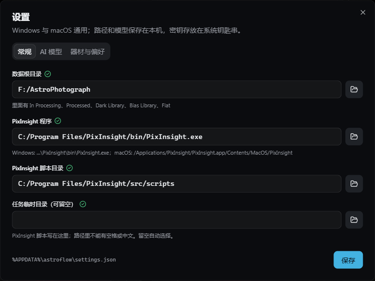
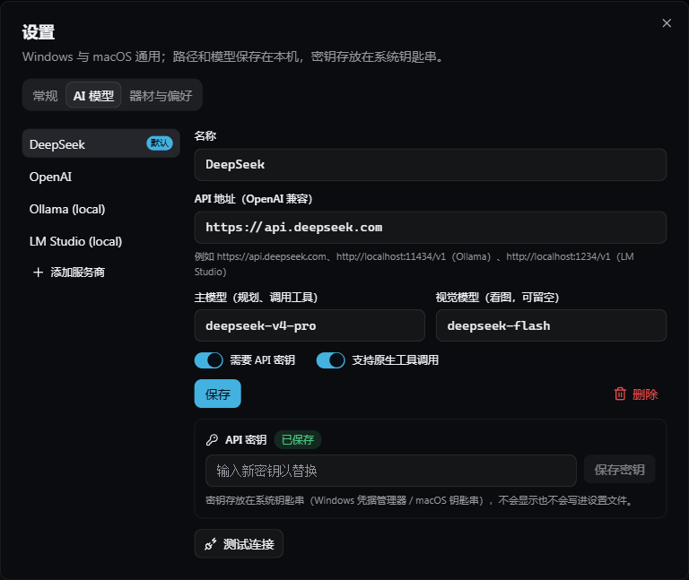
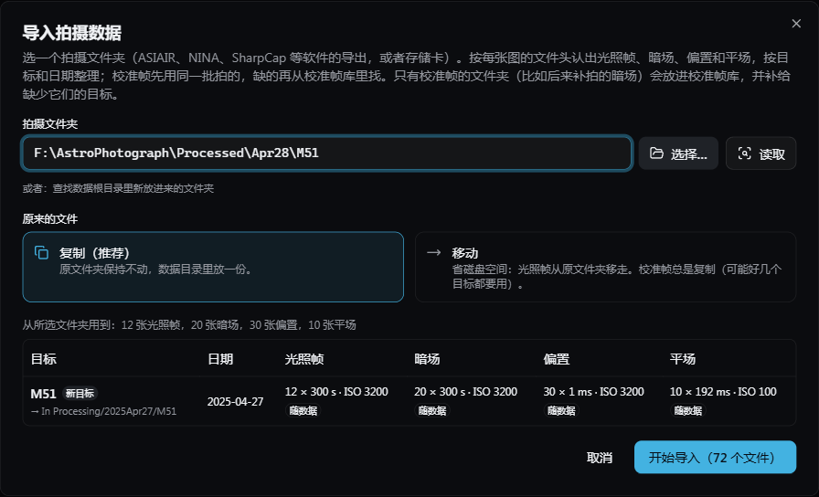
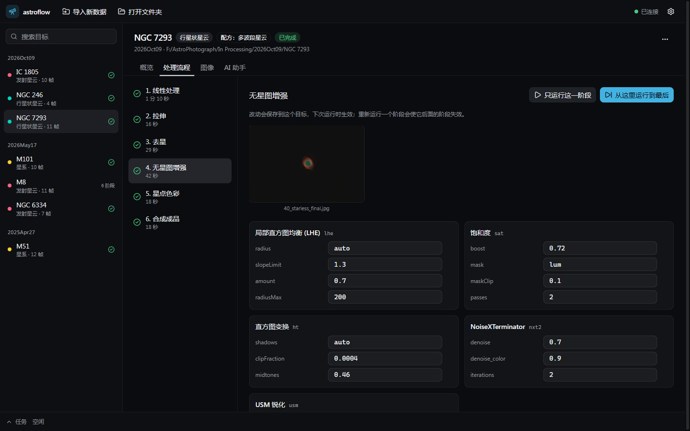
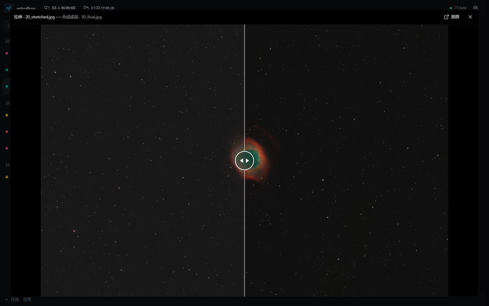
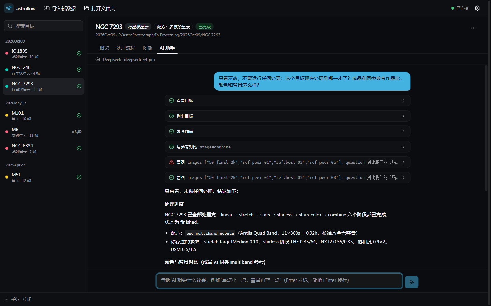

# astroflow 使用说明

适用版本：0.3.0。Windows 版已测试；macOS 版是预览版。

astroflow 把一晚（或几晚）的拍摄数据变成成品图。它会：
- 导入并整理文件，配好暗场、偏置、平场；
- 逐帧检查，挑出被云、风、跑焦影响的帧；
- 用 WBPP 叠加，几个晚上的数据也能合成一张；
- 按目标类型的配方在 PixInsight 里出图；
- 让 AI 助手对照同目标的高赞作品判断效果、调整参数（可选）；
- 做好发小红书、B站的分享图。

**处理由你电脑上的 PixInsight 完成**：astroflow 负责驱动它，不能替代它。


## 目录

1. [准备工作](#1-准备工作)
2. [安装](#2-安装)
3. [第一次设置](#3-第一次设置)
4. [导入拍摄数据](#4-导入拍摄数据)
5. [检查单帧](#5-检查单帧)
6. [叠加和出图](#6-叠加和出图)
7. [按自己的喜好调参数](#7-按自己的喜好调参数)
8. [看图和对比](#8-看图和对比)
9. [做分享图](#9-做分享图)
10. [AI 助手](#10-ai-助手)
11. [彗星](#11-彗星)
12. [任务栏和通知](#12-任务栏和通知)
13. [磁盘空间和归档](#13-磁盘空间和归档)
14. [文件放在哪里](#14-文件放在哪里)
15. [常见问题](#15-常见问题)
16. [隐私](#16-隐私)
17. [卸载](#17-卸载)

## 1. 准备工作

**软件**
- **PixInsight** 1.9 或更新（自带 WBPP 脚本）。
- **RC Astro 插件**：BlurXTerminator、NoiseXTerminator、StarXTerminator，装进 PixInsight 并激活。
- **Gaia DR3/SP 数据库**：SPCC 色彩校准要用。先在 PixInsight 界面里下载，再在 Gaia 进程里设好路径。
- **AI 模型**（可选）：DeepSeek / OpenAI 的 API 密钥，或者本机的 Ollama / LM Studio。不用 AI 也能导入、叠加、按配方出图和调参数。

**数据**
- **FITS**（`.fit` / `.fits`）：ASIAIR、NINA、SharpCap、Ekos 等拍摄软件存的格式。
- **相机 RAW**：单反、微单自己存的 CR2、CR3、NEF、ARW、DNG、RAF、ORF、RW2、PEF 等。富士的 X-Trans 也支持。
- 相机：彩色相机（OSC，包括单反、微单）和黑白相机。黑白相机用 L/R/G/B 宽带滤镜拍的数据有对应配方（见第 5 节）；黑白窄带（Ha、OIII、SII）还没有。黑白配方用叠加好的主帧测试过，从原始帧开始（WBPP 按滤镜分别叠加）还没用真实的黑白数据测过，遇到问题请反馈。

**数据根目录**：选一个文件夹放拍摄数据和处理结果（比如 `D:\Astro`），astroflow 会在里面按下面的结构整理：

```
数据根目录
├── In Processing\    正在处理的目标：<日期>\<目标>\Light、Dark、Bias、Flat …
│   └── Multi-night\  几个晚上合并叠加的目标
├── Processed\        处理完的目标（用“归档”挪进来，见第 13 节）
├── Dark Library\     校准帧库：暗场（里面怎么分文件夹都行）
├── Bias Library\     校准帧库：偏置
└── Flat\             校准帧库：平场
```

校准帧库是可选的，没有也能用。补拍的暗场、平场导入时会自动放进这里。

## 2. 安装

**Windows 10 / 11（64 位）**
1. 在 GitHub 的 Releases 页面下载 `astroflow-<版本>-setup.exe`。
2. 运行。安装包暂时没有数字签名，Windows 可能提示“Windows 已保护你的电脑”。点“更多信息”，再点“仍要运行”。
3. 选择安装位置，装好后从开始菜单或桌面打开 astroflow。

**macOS（Apple 芯片，预览版）**
1. 下载 `astroflow-<版本>-arm64.dmg`，把 astroflow 拖进“应用程序”。
2. 第一次打开会被系统拦下：到“系统设置 → 隐私与安全性”点“仍要打开”。
3. macOS 版还没在真机上完整测试过，遇到问题请到 Issues 反馈。

**更新到新版本**
- 打开 astroflow 时会到 GitHub 看有没有新版本。有的话，顶部栏右边出现“新版本 x.y.z”，点开能看到更新了什么。
- **Windows**：点“下载新版本”，下载完点“重启并安装”；不想现在重启的话，下次关闭 astroflow 时会自动装好。重启前会先停下正在运行的任务。
- **macOS**：点“打开下载页”，下载新的 .dmg 装上（预览版没有签名，系统不允许它自己更新）。
- 设置、密钥和数据都会保留。不想自动检查的话，到 设置 → 常规 关掉“启动时检查新版本”，需要时点“检查更新”。

## 3. 第一次设置

### 检查运行环境

第一次打开 astroflow，如果这台电脑上还缺东西，会自动弹出“检查运行环境”。它逐项检查：

| 项目 | 级别 | 缺了会怎样 |
|---|---|---|
| PixInsight 1.9 或更新 | 必需 | 不能叠加和出图 |
| PixInsight 脚本（WBPP、ImageSolver） | 必需 | 不能叠加；每个 PixInsight 任务都会失败 |
| RC Astro 插件（已安装并激活） | 必需 | 每个配方都要用，出图会失败 |
| 数据根目录、任务临时目录 | 必需 | 无处导入；PixInsight 任务启动不了 |
| Gaia DR3/SP 数据库 | 推荐 | SPCC 用不了，改用手动色彩校准，颜色没那么准 |
| AI 模型 | 可选 | 只有 AI 助手用不了 |

- 缺的项目下面有一步步的安装说明和官网链接；RC Astro 的更新地址可以一键复制。
- 能替你做的会给按钮：设置里的 PixInsight 路径不对但在常见位置找到了它，点“使用找到的 PixInsight”；数据根目录不存在，点“创建这个文件夹”。
- 插件激活和 Gaia 配置都保存在 PixInsight 的设置里，PixInsight **关掉时**才写进文件。所以在 PixInsight 里弄好以后先关掉它，再点“重新检查”。切回 astroflow 窗口时也会自动重新检查。
- 关掉窗口不影响使用。还缺必需组件时，顶部栏会显示“缺少 N 项组件”，点它再打开；也可以在 设置 → 常规 → “检查运行环境” 打开。
- 命令行：`python -m astroflow doctor` 打印同样的检查结果。

### 设置

点右上角的齿轮 ⚙ 打开设置。

### 常规



| 项目 | 填什么 |
|---|---|
| 界面语言 | 跟随系统（默认）、中文或 English。切换后马上生效，AI 助手也会用这种语言回答 |
| 版本和更新 | 当前版本、“检查更新”，以及要不要在启动时检查新版本 |
| 数据根目录 | 上一节说的文件夹 |
| PixInsight 程序 | Windows：`C:\Program Files\PixInsight\bin\PixInsight.exe`<br>macOS：`/Applications/PixInsight/PixInsight.app/Contents/MacOS/PixInsight` |
| PixInsight 脚本目录 | PixInsight 安装目录下的 `src\scripts` |
| 任务临时目录 | 可以留空。PixInsight 的任务脚本写在这里，路径里不能有空格或中文（PixInsight 的限制）。出现黄色警告时，指定一个比如 `D:\astroflow-runs` |

绿色的勾表示路径可用，改完点“保存”。

### AI 模型



- 预设了 DeepSeek、OpenAI、Ollama（本地）、LM Studio（本地）四个服务商，也可以“添加服务商”接入任何 OpenAI 兼容接口。
- **密钥**：在“API 密钥”里粘贴后点“保存密钥”，再点“测试连接”确认能用。密钥存在系统钥匙串（Windows 凭据管理器 / macOS 钥匙串），不写进设置文件，界面上也不显示，需要时可以“删除密钥”。
- **主模型**负责规划和调用工具；**视觉模型**负责“看图”判断效果。视觉模型可以留空，这时 AI 只按数值判断。
- **本地模型**：比如 Ollama，先运行 `ollama pull <模型名>`，地址填 `http://localhost:11434/v1`，关掉“需要 API 密钥”。如果模型不支持工具调用，关掉“支持原生工具调用”，AI 会改用提示词方式，效果可能差一些。
- 有几个服务商时，点“设为默认”选一个用。

### 器材与偏好

- **器材**：相机、望远镜、焦距等。文件头里缺这些信息时会用这里的，也会告诉 AI。分享图的拍摄信息里，焦距和这里一致时写望远镜的名字。
- **主体色度目标**：成品主体颜色的浓淡，以同类参考作品为基准（默认 0.8–1.2 倍）。AI 调色时按这个来。
- **成品导出格式**：PNG、JPG、TIF（16 位）可多选。

## 4. 导入拍摄数据



1. 点顶部的“导入新数据”。
2. 点“选择…”选一个拍摄文件夹，或者粘贴路径后按回车。这些都可以：
   - ASIAIR 的 Autorun 文件夹；
   - NINA 某一晚的文件夹；
   - 相机存储卡；
   - 已经分好 Light、Dark、Bias、Flat 的目标文件夹。
3. 看计划：
   - **每行一个目标**，并标出它是“新目标”“补全已有目标”“加入校准帧库”还是“已导入”。
   - **光照帧 / 暗场 / 偏置 / 平场**：显示张数、曝光、增益（单反显示 ISO）、制冷温度、滤镜。“随数据”表示来自你选的文件夹，“校准帧库”表示从库里找来的。
   - **黄色提示**说明缺什么，比如“缺少暗场：180 s、增益 100、-10 °C”。
   - **表格上方**列出没用上的文件，比如没有对应光照帧的暗场、ASIAIR 的预览图、读不了的文件。
4. 选“复制（推荐）”或“移动”，点“开始导入”。
   - 复制：原文件夹保持不动。
   - 移动：光照帧会从原文件夹移走；校准帧总是复制，因为可能几个目标都要用。

导入在任务栏里进行，可以随时停止。中断时不会留下只拷了一半的文件。

**它怎么认文件**
- **帧类型**：看文件头的 IMAGETYP；没有的话看文件名或文件夹名（Light、Darks、FLAT、Bias …）。只从名字认出类型的 FITS 文件，复制时会把类型写进副本的文件头，原文件不改。
- **相机 RAW 文件**：曝光、ISO、相机型号和拍摄时间从 RAW 里读。RAW 不记录帧类型，所以要放在名字是 Light、Dark、Flat、Bias（或 Lights、Darks …）的文件夹里。RAW 文件原样复制，不改动。
- **目标名**：看文件头的 OBJECT；没有就用文件夹名。
- **日期**：本地时间减 12 小时，午夜后拍的归到前一晚。相机 RAW 用相机里设的时间。
- **暗场**：相机、尺寸、binning、增益（ISO）、偏移、曝光都要一致，制冷温度相差 1 °C 以内，最接近的优先。单反等没有温度信息的相机，优先用同一晚拍的。
- **偏置**：同暗场，但不看曝光。
- **平场**：相机、尺寸、binning、滤镜一致，并且是同一晚拍的；增益可以不同（平场常用另一个 ISO）。暗平场会一起带上。
- **优先顺序**：先用你选的文件夹里同一批拍的，没有再去校准帧库里找。
- **不会导入的**：WBPP 的输出、master 文件、ASIAIR 的 Preview 预览图、相机同时存的 JPG。

**补拍的暗场 / 平场**：直接导入只有校准帧的那个文件夹。它会被放进校准帧库，并自动补给 In Processing 里缺这些帧的目标。

**不复制，直接打开一个目标文件夹**：点顶部“打开文件夹”，选一个包含 `Light` 或 `Post` 的文件夹，就地处理。不想看到它时，在目标页右上角“⋯”里选“从列表中移除”，文件不会被删。

**记下这一晚用的滤镜**（彩色相机）：文件头里不记录滤镜。用了多波段 / 窄带滤镜（比如 Antlia 四通道）的话，到目标概览的“拍摄数据”里，把“这一晚的滤镜”改成“多波段 / 窄带”。它决定用哪个配方，以及和哪类参考作品比较。

## 5. 检查单帧

叠加前先看看每一帧拍得怎么样。目标页 → “单帧检查” → “检查单帧”（大约每 6 帧 1 分钟，不用 PixInsight）。

- 每一帧一张缩略图，下面是拍摄时间（当地时间）、星点数和星点大小（FWHM，知道像素大小和焦距时用角秒，否则用像素）。
- 上面两排小柱子是整晚的走势：星点数突然变少多半是来了云或结露，星点变大是跑焦、视宁度变差或起风。
- **可疑的帧**标成黄色，并写明原因。可疑是和这个目标的其他帧比：
  - 星点数不到其他帧的一半：云、雾或结露；
  - 星点明显变大：跑焦、视宁度差或有风；
  - 星点被拉长：跟踪不准或有风；
  - 背景明显变亮：月光、云或天快亮了。
- **排除**：点“排除全部可疑帧”，或者勾选几帧后点“排除所选”。排除的帧移到目标文件夹的 `Excluded` 里，不会删除，随时能“恢复”。
- 已经叠加过的目标，排除或恢复以后会提示“重新叠加”。重新叠加后，之前出图的各阶段会作废，再按配方出图即可；“全部处理”也会把这样的目标重新叠加、出图。
- “重新检查”会把所有帧重新测一遍；新导入的帧在下次检查时自动补上。

## 6. 叠加和出图

左边列表选一个目标，“概览”页的“下一步”会告诉你该做什么：

1. **WBPP 叠加**（5–20 分钟）：校准、配准、叠加。WBPP 会做板解析（需要联网），算出图像的天球坐标，后面 SPCC 色彩校准要用。
2. **按配方处理**（每个目标一般 3–7 分钟）。配方按目标类型自动选：

   | 配方 | 用于 |
   |---|---|
   | 宽带星云 | 发射星云、反射星云、行星状星云、超新星遗迹，无滤镜拍摄 |
   | 星系 | 星系 |
   | 多波段星云 | 星云，用多波段 / 窄带滤镜拍摄 |
   | 彗星 | 彗星（见第 11 节） |
   | 黑白 LRGB 星系 / 星云 | 黑白相机的 L/R/G/B 数据（WBPP 每个滤镜叠出一张主帧时自动选用） |

   每个配方都是六个阶段：线性处理 → 拉伸 → 去星 → 无星图增强 → 星点色彩 → 合成成品。黑白配方开头不同：通道对齐与合成（R/G/B 对齐到 L、裁掉对不上的边、各自去背景、合成彩色图）→ 色彩校准 → 亮度通道 L（去卷积、降噪）→ 拉伸（L 按彩色图的亮度拉伸后合成进去），之后相同。没有 L 时用 R/G/B 的平均代替。
3. **成品**：做完后概览页显示成品，下面是成品文件（JPG、PNG、TIF），点一下用系统软件打开，或者“打开所在文件夹”。

列表里的标记：
- 圆点颜色表示天体类型；
- ✓ 表示已出成品；
- “N 阶段”表示做到第几阶段；
- 转圈表示正在处理。

**认不出天体类型时**：内置星表只认识常见目标，不认识的会标“未知类型”。到“处理流程”里选一个配方就行，也可以在 AI 助手里告诉它这是什么天体。

**运行任务时请关掉 PixInsight 界面**：astroflow 在后台启动无界面的 PixInsight，同一时间只能有一个 PixInsight（第二个实例读不到 Gaia 数据库，BlurXTerminator 也会出错）。PixInsight 开着时，任务会等待，并在任务栏提示。

### 全部处理

顶部的“全部处理”把还没出图的目标排进队列，一个接一个处理：没叠加的先用 WBPP 叠加，再按配方出图。打开后先列出每个目标要做什么，已完成的、认不出类型的会说明为什么跳过；可以取消勾选不想处理的目标。全部完成后会弹出系统通知（见第 12 节），可以先去做别的。

### 几个晚上的数据合成一张

同一个目标拍了好几晚，每晚导入后都是单独的目标（`In Processing\<日期>\<目标>`）。打开其中任何一晚，概览页会出现“拍了 N 个晚上”：

1. 勾选要合并的晚上，点“合并叠加”。
2. 左边列表最上面出现“多晚合并”里的这个目标（`In Processing\Multi-night\<目标>`），之后和普通目标一样叠加、出图。
3. 之后又拍了新的一晚：导入后打开合并的目标，勾上新的晚上，点“更新合并”。

- 每晚的光照帧用这一晚自己的平场（和暗场）校准，然后所有晚上一起配准、叠加成一张。
- 合并的目标里放的是指向原文件的链接，不多占磁盘空间（磁盘不支持链接时才会复制一份）。原来每一晚的目标不变。
- “全部处理”会处理合并的目标，不再单独处理已经合并进去的那几晚。
- 某一晚归档或删除以后，它的帧仍留在合并的目标里，不会因为更新合并而丢掉。
- 在某一晚里排除或新增了帧，打开合并的目标点“更新合并”同步过去。

## 7. 按自己的喜好调参数



“处理流程”页：
- **左边**是六个阶段，显示是否完成、用时，以及是否改过参数。
- **右边**是选中阶段的预览图和每一步的参数，比如饱和度、降噪强度、局部对比度（LHE）、拉伸后的背景亮度、星点合并强度。
- **保存**：改一个值就自动保存到这个目标，以后每次运行都会用。不管是你点运行、让 AI 运行，还是用命令行，都一样。改过的参数旁边会显示默认值，点 ↺ 恢复，“恢复本阶段默认值”一次恢复整个阶段。
- **运行**：“只运行这一阶段”或“从这里运行到最后”。重跑一个阶段后，它后面的阶段需要重新跑。中间结果被清理掉的话，会先自动重跑做出它的阶段。
- 处理过程中正在运行的阶段会转圈，这时参数不能改。

### 我的风格

调出满意的效果以后，可以把这套参数存起来，用到其他目标上：

1. 在“处理流程”页点“我的风格” → “把这个目标的参数存为风格…”，起个名字，比如“浓郁星云”。
2. 打开另一个用同一配方的目标（比如另一个宽带星云），点“我的风格”，选这个风格。目标自己改过的参数会被替换成风格里的（会先问你），下次运行时生效。

风格只记你改过的参数，其余仍用配方的默认值。不用的风格把鼠标移上去点垃圾桶删除。

## 8. 看图和对比



“图像”页：
- **三组图**：成品、各阶段预览、参考作品（同目标在 AstroBin 上的高赞作品缩略图，只在本机用来比较）。
- **查看**：点一张图放大，滚轮缩放，拖动平移；“原图”用系统看图软件打开。
- **对比两张图**：依次点两张，拖动中间的滑块对比。比如拉伸后和成品，或者成品和一张参考作品。

参考作品要先在概览页点“抓取同目标高赞作品作参考”（需要联网）。

## 9. 做分享图

出了成品以后，概览页的“做分享图”（或者目标页右上角“⋯”）：

1. **选比例**：3:4（小红书）、4:5（朋友圈、Instagram）、1:1、16:9（B站、视频封面），或者原比例。
2. **框出画面**：方框一开始就放在主体上（星系按星表位置，星云找最亮、颜色最多的区域）。拖动方框换位置，拖右下角调大小，形状保持不变。
3. **拍摄信息**：默认写目标名（常见目标带中文名）、望远镜、相机、曝光和总时长、日期，可以随便改，第一行是标题。**不会写拍摄地点**。不想要就关掉开关。
4. **署名**：比如“© 你的名字”，写在右下角；留空就不加。下次会记住。
5. 右边的预览就是导出的样子。点“导出图片”。

导出的 JPG 在 `Post\share\`，尺寸按平台常用的大小（3:4 是 1620×2160，16:9 是 2560×1440），不会放大成品本身没有的细节。原来的成品不改动。

## 10. AI 助手



目标页 → “AI 助手” → “开始对话”，然后直接说想要的效果，比如：
- “按流程完整处理这个目标，并和参考作品比较”
- “饱和度再高一点，背景再暗一点”
- “和参考作品比一下，还差在哪里？”
- “只重做无星图增强（starless）阶段”

它会读拍摄数据和资料库，按配方运行 PixInsight，用视觉模型看每一步的结果，和高赞作品比较颜色、对比度、背景，然后调整参数重跑，最后写一份报告（`Post\report.md`）。每一步都显示在对话里，点开能看到参数和结果。

- **参数**：它在你保存的参数基础上调整，不会改掉你保存的参数。
- **停止**：“停止”随时结束，正在运行的 PixInsight 也会结束。AI 的工作也在任务栏里，在那里停止效果一样。
- **只问不改**：说清楚“只看不改，不要运行任何处理”。
- **提示标签**：显示“无视觉模型：只按指标判断”，说明当前服务商没配视觉模型；显示“提示词工具模式”，说明模型不支持原生工具调用。
- **费用**：每次回答下面会显示用了多少 token。本地模型不花钱。

## 11. 彗星

文件名或 OBJECT 像 `C/2025 R3`、`C2025-R3`、`12P` 的目标会被认作彗星，分三步：

1. **WBPP 校准和配准**：概览页“第 1 步”。
2. **彗星叠加**（约 10–15 分钟）：概览页“第 2 步”。
   - 按星点和按彗核分别叠加，合成时彗核清楚、星点不拖线。
   - 自动处理云、卫星轨迹，以及长短不一的曝光。
   - 每帧的权重图在 `Post\weights.jpg`，黑色是被剔除的部分（云、轨迹）。
3. **按配方处理**：用彗星配方出成品。

## 12. 任务栏和通知

窗口底部是任务栏：
- 同一时间只运行一个任务，其余排队；
- 点开能看到每个任务的实时日志；
- 点“停止”结束正在运行的任务（包括它启动的 PixInsight）；
- 关闭 astroflow 时，正在运行的任务会被停止，不会在后台留下 PixInsight。

**完成通知**：astroflow 在后台（窗口最小化或在用别的程序）时，队列里的任务全部跑完会弹出一条系统通知，说明完成了什么、有没有失败。点通知回到 astroflow，并打开相关的目标。在 astroflow 前台时不弹通知，看窗口里的提示就行。没看到弹窗的话，检查系统的“专注助手 / 勿扰模式”，通知也会留在系统的通知中心里。

## 13. 磁盘空间和归档

**磁盘空间**：点右上角的硬盘图标（或目标页“⋯” → “清理中间文件…”）。每个目标显示占了多少空间、分在哪里：

| 部分 | 是什么 | 会被清理吗 |
|---|---|---|
| 原始帧 | 光照帧和校准帧 | 不会 |
| 叠加结果 | WBPP 的 master | 不会 |
| WBPP 中间单帧 | 校准、去马赛克、配准后的单帧，通常最大（一个目标十几 GB） | 会，重新叠加时再生成 |
| 处理中间结果 | 各阶段的中间图（最终成品除外） | 会，重跑阶段时自动补回 |
| 成品和预览 | 成品图、预览、分享图 | 不会 |

勾选目标后点“释放 …”。只删上表里的两类，`Output` 里你自己放的其他文件夹和文件不会动；彗星配准后的单帧总是保留（彗星叠加要用）。合并多晚的目标里的帧是链接，不重复计算空间。

**归档**：处理完的目标，在概览页“归档到 Processed”（或目标页“⋯”里）。整个目标文件夹从 `In Processing\<日期>\<目标>` 移到 `Processed\<日期>\<目标>`，这一晚的滤镜记录一起带过去，处理记录里的路径也会更新。可以顺便勾上“同时删掉可以再生成的中间文件”。归档后它不在左侧列表里，需要时用“打开文件夹”再打开。

## 14. 文件放在哪里

一个目标的文件夹：`数据根目录\In Processing\<日期>\<目标>\`（合并多晚的是 `In Processing\Multi-night\<目标>\`）

| 位置 | 内容 |
|---|---|
| `Light`、`Dark`、`Bias`、`Flat` | 导入的帧（合并多晚的目标按 `NIGHT_<日期>` 分文件夹） |
| `Excluded\Light` | 单帧检查时排除的帧 |
| `frames.json`、`Thumbnails\frames\` | 单帧检查的结果和缩略图 |
| `calibration_manifest.txt` | 这个目标用了哪些校准帧、从哪来、还缺什么 |
| `Output\` | WBPP 的输出（master、配准帧、日志） |
| `Post\<目标>_<日期>.png / .jpg / .tif` | 成品（PNG、JPG 为 8 位全分辨率；TIF 为 16 位，可以继续在 Photoshop 里调）；`_crop` 是裁切版 |
| `Post\share\` | 分享图 |
| `Post\previews\` | 每个阶段的预览图 |
| `Post\report.md` | AI 的处理报告 |
| `Post\params.json` | 你在“处理流程”里保存的参数 |
| `Post\state.json` | 各阶段的运行记录 |
| `Post\NN_*.xisf` | 各阶段的检查点（可以在 PixInsight 里打开） |

应用自己的文件（Windows / macOS）：

| 内容 | Windows | macOS |
|---|---|---|
| 设置 | `%APPDATA%\astroflow\settings.json` | `~/Library/Application Support/astroflow/settings.json` |
| 我的风格 | `%APPDATA%\astroflow\presets.json` | `~/Library/Application Support/astroflow/presets.json` |
| 应用日志 | `%APPDATA%\astroflow\logs\backend.log` | `~/Library/Logs/astroflow/backend.log` |
| PixInsight 任务（每个任务一个文件夹，含日志） | `%LOCALAPPDATA%\astroflow\Cache\runs` | `~/Library/Caches/astroflow/runs` |
| 资料库副本（流程、参数、检查标准、参考作品） | `%LOCALAPPDATA%\astroflow\knowledge` | `~/Library/Application Support/astroflow/knowledge` |

## 15. 常见问题

**任务一直显示 “waiting: PixInsight is open …”**
关掉 PixInsight 界面，任务会自动开始。

**WBPP 叠加或色彩校准失败**
- 先打开“检查运行环境”（设置 → 常规），看有没有红色或黄色的项目。
- 确认 PixInsight 里配好了 Gaia DR3/SP 数据库。
- 确认 RC Astro 插件已激活。
- WBPP 的板解析需要联网。
- 展开任务栏看日志；PixInsight 端更详细的日志在任务临时目录里对应任务的文件夹中。

**设置里“任务临时目录”有黄色警告**
路径里有空格或中文（比如用户名是中文）。指定一个路径简单的文件夹，比如 `D:\astroflow-runs`。

**AI “测试连接”失败**
- 检查 API 地址、密钥和模型名。
- 本地模型：确认 Ollama / LM Studio 正在运行，并且已经下载了这个模型。
- 模型不支持工具调用时，关掉“支持原生工具调用”。

**导入计划里有“缺少暗场 / 平场”**
- 补拍后导入那个文件夹，会自动补给这个目标。
- 也可以不补，直接叠加：没有暗场，噪声和热像素会多一些；没有平场，暗角和灰尘印子会留在图里。

**导入计划上方说有文件“看不出是光照帧还是校准帧”**
这些文件的文件头里没有 IMAGETYP，文件名和文件夹名也看不出（相机 RAW 文件总是这样）。把它们放进叫 `Light`、`Dark`、`Flat`、`Bias` 的文件夹再导入。

**单反的暗场配不上**
暗场要和光照帧的曝光、ISO 一样。相机没有温度记录，会优先用同一晚拍的暗场。

**目标显示“未知类型”**
到“处理流程”里选一个配方。

**还有问题**
到 GitHub 的 Issues 里提，附上任务日志和 `backend.log` 会更容易查。

## 16. 隐私

- 所有处理都在你的电脑上进行，拍摄数据不会上传。
- 用云端 AI（DeepSeek、OpenAI 等）时，发送给服务商的是处理过程中的数值和预览小图（最长边 1600 像素）；用本地模型时完全离线。
- 抓取参考作品时会访问 AstroBin；WBPP 板解析时会查询在线星表。
- 检查新版本时会访问 GitHub，只读取发布信息，不上传你的文件、设置或密钥；可以在设置里关掉。
- 分享图的拍摄信息不包含拍摄地点。
- API 密钥存在系统钥匙串，不写进任何文件。

## 17. 卸载

- **Windows**：设置 → 应用 → astroflow → 卸载。
- **macOS**：把 astroflow 拖到废纸篓。

设置、日志和资料库副本还留在第 14 节列出的位置，可以手动删掉。删除密钥：卸载前在设置里点“删除密钥”，或者到 Windows 凭据管理器 / macOS 钥匙串里删掉 astroflow 的条目。你的拍摄数据和成品都在数据根目录里，卸载不会动它们。

---

命令行用法（不开应用，直接跑整理、叠加、配方、AI）见 [README](../README.zh-CN.md#命令行)。
